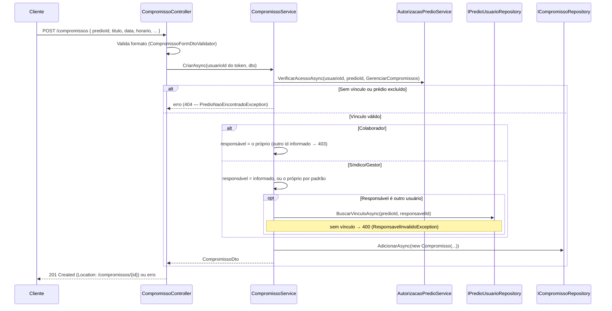

# Compromissos — Backend euSíndico

Este documento descreve o CRUD de compromissos (RF12–RF17, RF34, RNF10, RN03, RN06, RN09, RN10, RN14, RN20–RN22) do [RFC](../../documentation/RFC/RFC.md). Referência para `CompromissoController`/`CompromissoService`/`CompromissoRepository`.

> **Status:** implementado — `POST`/`GET`/`GET {id}`/`PUT`/`PATCH`/`DELETE /compromissos`. Migration `AddResponsavelAoCompromisso`.

## Sumário

- [Visão geral](#visão-geral)
- [Onde cada peça mora na arquitetura](#onde-cada-peça-mora-na-arquitetura)
- [Entidade Compromisso](#entidade-compromisso)
- [Regras de negócio aplicadas](#regras-de-negócio-aplicadas)
- [Endpoints](#endpoints)
- [Listagem: filtros, escopo e ordenação](#listagem-filtros-escopo-e-ordenação)
- [Fluxo 1 — Criar (RF12, RF13)](#fluxo-1--criar-rf12-rf13)
- [Fluxo 2 — Listar (RF14, RF34)](#fluxo-2--listar-rf14-rf34)
- [Fluxo 3 — Obter](#fluxo-3--obter)
- [Fluxo 4 — Editar, reatribuir e mover (RF15)](#fluxo-4--editar-reatribuir-e-mover-rf15)
- [Fluxo 5 — Concluir e reabrir (RF17)](#fluxo-5--concluir-e-reabrir-rf17)
- [Fluxo 6 — Remover (RF16)](#fluxo-6--remover-rf16)
- [Validação de entrada e sanitização](#validação-de-entrada-e-sanitização)
- [Fuso horário](#fuso-horário)
- [Exclusão de conta e responsável](#exclusão-de-conta-e-responsável)
- [Segurança](#segurança)
- [Decisões confirmadas](#decisões-confirmadas)
- [Pendências](#pendências)
- [Testes](#testes)

## Visão geral

- Todo endpoint exige `[Authorize]`; `usuarioId` vem sempre da claim `sub`, nunca do corpo ou da rota (RN02).
- **Um único conjunto de rotas, `/compromissos`.** A tela global e a tela de um prédio chamam o mesmo `GET /compromissos` — a segunda só acrescenta `predioId`. Não existe `/predios/{id}/compromissos` (o desenho original do [EQUIPE.md](EQUIPE.md) previa as duas e foi simplificado: dois endpoints fazendo a mesma coisa seriam duplicação).
- **Autorização em duas camadas:** (1) *vínculo* com o prédio via `AutorizacaoPredioService` (`AcaoPredio.GerenciarCompromissos`, permitido aos três papéis) e prédio não excluído; (2) *posse* do compromisso, aplicada no `CompromissoService`: Colaborador só mexe nos que ele é responsável (RN21). A segunda não cabe no `AutorizacaoPredioService` porque depende do compromisso, não só do papel.
- **Todo compromisso tem um responsável** (`responsavel_usuario_id`, RN20), que decide quem o enxerga como "meu" (RF34) e quem, sendo Colaborador, pode mexer nele.
- **Remoção física** (sem `excluido`): diferente de Prédio (RN08), o RFC não pede soft delete aqui, e a exclusão de conta (RF07) também é permanente.
- **Concluir é reversível**, e compromisso concluído continua editável e removível — o "concluído" é só um estado marcado por checkbox no celular, fácil de clicar errado.

## Onde cada peça mora na arquitetura

| Componente | Camada | Responsabilidade |
|---|---|---|
| `Compromisso` | Domain | Entidade; `AtualizarDados`, `Concluir`, `Reabrir`, `AtribuirResponsavel`. |
| `CompromissoConfiguration` | Infrastructure | Tabela `compromissos`, FK `Restrict` para prédio e responsável, índices. |
| `ICompromissoRepository` / `CompromissoRepository` | Application / Infrastructure | `BuscarPorIdAsync`, `ListarAsync(CompromissoFiltro, page, pageSize)`, `Adicionar`, `Atualizar`, `Remover`. |
| `CompromissoService` | Application | Casos de uso; aplica RN09, RN20, RN21; resolve "hoje/agora" pelo `TimeProvider`. |
| `AcaoPredio.GerenciarCompromissos` | Application | Acrescentada à matriz do `AutorizacaoPredioService` (os três papéis). |
| `EscopoCompromissos`, `SituacaoCompromissos`, `CompromissoFiltro` | Application | Parâmetros da listagem. |
| `CompromissoFormDto`, `AlterarConclusaoDto`, `CompromissoDto` | Application | Entrada (criar/editar e concluir) e saída. |
| `CompromissoNaoEncontradoException` (`404`), `ResponsavelInvalidoException` (`400`) | Application | Mapeadas no `ApplicationExceptionHandler`. `PredioNaoEncontradoException` e `AcaoNaoPermitidaException` são **reaproveitadas**. |
| `CompromissoController` | Api | Rotas, validação de entrada e dos parâmetros de listagem. |
| `CompromissoFormDtoValidator`, `AlterarConclusaoDtoValidator`, `TituloValidator`, `PrestadorServicoValidator`, `DetalhesValidator` | Api | Validação de formato (ver [seção](#validação-de-entrada-e-sanitização)). |
| `FusoHorarioTimeProvider` | Infrastructure | `TimeProvider` com o fuso da aplicação. |

## Entidade Compromisso

```csharp
public class Compromisso
{
    public int Id { get; private set; }
    public string Titulo { get; private set; }
    public DateOnly DataCompromisso { get; private set; }
    public TimeOnly HorarioCompromisso { get; private set; }
    public string? NomePrestadorServico { get; private set; }
    public decimal? Orcamento { get; private set; }         // opcional — alimenta o total do relatório mensal
    public string? Detalhes { get; private set; }
    public bool Concluido { get; private set; }
    public int PredioId { get; private set; }
    public int ResponsavelUsuarioId { get; private set; }   // novo — RN20, RF34
    public DateTime CriadoEm { get; private set; }

    public Predio? Predio { get; private set; }
    public Usuario? Responsavel { get; private set; }
}
```

Migration `AddResponsavelAoCompromisso`: coluna `responsavel_usuario_id INT NOT NULL`, FK para `usuarios` com `Restrict` (RN22 — remover um funcionário não apaga os compromissos dele) e índice `(predio_id, responsavel_usuario_id)` (filtro "meus", RF34).

> ⚠️ A coluna é criada com `DEFAULT 0`, que violaria a FK se já houvesse linhas em `compromissos`. Não havia nenhuma (o módulo não existia), então a migration aplica limpa. **Num banco com compromissos de teste inseridos à mão, limpe a tabela antes de aplicar.**

Migration `AddOrcamentoAoCompromisso`: coluna `orcamento DECIMAL(10,2) NULL` (mesmo tipo de `orcamento_previsto` em planejamentos). Linhas existentes ficam com `NULL` ("não informado").

## Regras de negócio aplicadas

| Regra | Como é aplicada |
|---|---|
| RN03 — compromisso sempre vinculado a um prédio | `predioId` obrigatório (`> 0`) e checado contra o vínculo do usuário. |
| RN09 — prédio excluído não aceita cadastro/edição | `AcessarPredioAsync` trata `Predio.Excluido` como "não existe" (`404`) em criar, editar, mover (destino), concluir e remover. |
| RN08 (leitura) — prédio excluído some das telas | A listagem filtra `!Predio.Excluido`; obter por id devolve `404`. |
| RN10 — data e horário obrigatórios | `DateOnly?`/`TimeOnly?` no DTO + `NotNull` — `TimeOnly` sem valor viraria `00:00` silenciosamente. Datas passadas **são permitidas** (registro de atividade já realizada). |
| RN14 — ordem cronológica crescente | `ORDER BY data, horario, id` (o `id` desempata para a paginação ser estável). |
| RN16 — só com vínculo explícito | Toda operação passa pelo vínculo do `predio_usuarios`. |
| RN20 — responsável conforme o perfil | Ver [Fluxo 1](#fluxo-1--criar-rf12-rf13) e [Fluxo 4](#fluxo-4--editar-reatribuir-e-mover-rf15). |
| RN21 — Colaborador só mexe nos próprios | Ver [Segurança](#segurança) e [Listagem](#listagem-filtros-escopo-e-ordenação). |
| RN22 — remover acesso não apaga compromissos | FK `Restrict`; o compromisso continua apontando para o ex-membro até alguém reatribuir. |
| RNF10 — paginação | `page`/`pageSize` (padrão `1`/`10`, `pageSize` máx. `20`), fora da faixa → `400`, mesmo envelope `PagedResultDto<T>` de [PREDIOS.md](PREDIOS.md). |
| RN06 — só concluídos compõem relatórios | Fora deste CRUD; o módulo de Relatórios consulta `concluido = true`. |

## Endpoints

| Método | Rota | Ação | Sucesso | Erros possíveis |
|---|---|---|---|---|
| `POST` | `/compromissos` | Criar (RF12, RF13) | `201` + `Location` | `400`, `403` (Colaborador indicando outro responsável), `404` (prédio) |
| `GET` | `/compromissos` | Listar, paginado (RF14, RF34) | `200` | `400` (parâmetros), `404` (`predioId` sem vínculo/excluído) |
| `GET` | `/compromissos/{id}` | Detalhes | `200` | `403` (Colaborador, compromisso alheio), `404` |
| `PUT` | `/compromissos/{id}` | Editar, reatribuir, mover (RF15) | `200` | `400`, `403`, `404` |
| `PATCH` | `/compromissos/{id}` | Concluir/reabrir (RF17) — corpo `{ "concluido": true\|false }` | `200` | `400`, `403`, `404` |
| `DELETE` | `/compromissos/{id}` | Remover (RF16) | `204` | `403`, `404` |

Corpo de `POST`/`PUT` (`CompromissoFormDto`):

```json
{
  "predioId": 10,
  "titulo": "Visita técnica do elevador",
  "dataCompromisso": "2026-10-20",
  "horarioCompromisso": "14:30:00",
  "nomePrestadorServico": "Elevadores Atlas Ltda.",
  "orcamento": 1500.50,
  "detalhes": "Levar o relatório da última revisão.",
  "responsavelUsuarioId": 5
}
```

`nomePrestadorServico`, `orcamento`, `detalhes` e `responsavelUsuarioId` são opcionais. No `PUT`, omitir `orcamento` (ou enviar `null`) **o limpa**, como nos demais campos opcionais. Resposta (`CompromissoDto`): os mesmos campos mais `id`, `concluido`, `predioNome`, `responsavelNome` e `criadoEm` — o front não precisa de uma segunda chamada para exibir os nomes.

**Por que `PATCH` e não `PUT` para concluir:** o checkbox da lista só informa o estado desejado. Com `PUT` teria que reenviar o compromisso inteiro, e um clique no celular poderia sobrescrever uma edição feita por outra pessoa no intervalo. `PATCH` é parcial e idempotente (marcar duas vezes é a mesma coisa). As permissões são idênticas às de editar, então não há motivo de autorização para um endpoint de "ação" separado — por isso é `PATCH /compromissos/{id}`, não `POST /compromissos/{id}/concluir`. O campo é `bool?` no DTO e obrigatório: um `{}` não reabre o compromisso por engano.

## Listagem: filtros, escopo e ordenação

`GET /compromissos` aceita, todos opcionais e combináveis:

| Parâmetro | Valores | Padrão | Observação |
|---|---|---|---|
| `titulo` | texto (máx. 150) | — | Busca por trecho no título. |
| `predioId` | id | todos os prédios do usuário | Exige vínculo (senão `404`, mesma resposta de "não existe"). É o que a tela do prédio envia. |
| `escopo` | `meus` \| `todos` | `meus` | RF34. Ver abaixo. |
| `situacao` | `proximos` \| `hoje` \| `atrasados` \| `concluidos` | `proximos` | Ver abaixo. |
| `page`, `pageSize` | `>= 1`, `1..20` | `1`, `10` | RNF10. |

**`escopo`** — `meus` devolve só os compromissos em que o usuário é o responsável (o caso "abro a tela e vejo o que é meu"). `todos` devolve tudo dos prédios onde o papel dele **não** é Colaborador, mais os próprios. **Colaborador ignora `escopo`:** sempre vê só os dele, mesmo enviando `todos` (RN21 é restrição, não preferência de tela). Como o papel é por prédio (RN18), a regra vale por prédio: quem é Síndico em A e Colaborador em B, com `escopo=todos`, vê tudo de A e só o próprio de B.

**`situacao`** (os filtros do RFC 3.1), comparando com "hoje/agora" no [fuso da aplicação](#fuso-horário):

| Valor | Devolve |
|---|---|
| `proximos` (padrão) | **Não concluídos** com data `>=` hoje. |
| `hoje` | **Não concluídos** com data `=` hoje. |
| `atrasados` | **Não concluídos** com data `<` hoje, ou data `=` hoje e horário `<` agora. |
| `concluidos` | **Todos os concluídos**, em qualquer data. |

Um compromisso de hoje cujo horário já passou e que não foi concluído aparece em `proximos`, `hoje` **e** `atrasados`. Concluídos só aparecem em `concluidos`. Compromisso exatamente no horário atual ainda não é atrasado.

**Ordenação:** sempre `data ASC, horario ASC, id ASC` (RN14), inclusive em `concluidos`.

## Fluxo 1 — Criar (RF12, RF13)



`Titulo`, `NomePrestadorServico` e `Detalhes` levam `.Trim()` no Service; opcionais vazios ou só com espaços viram `null`.

## Fluxo 2 — Listar (RF14, RF34)

`CompromissoService.ListarAsync`: se `predioId` veio, confere vínculo e prédio ativo (`404` caso contrário); calcula `hoje`/`agora` no fuso da aplicação; monta o `CompromissoFiltro` e delega ao repositório. A visibilidade é decidida numa única consulta: o compromisso aparece se existe um vínculo `(usuário, prédio)` **e** (o usuário é o responsável **ou** (`escopo=todos` **e** o papel dele naquele prédio não é Colaborador)). Prédios excluídos são filtrados na mesma consulta.

## Fluxo 3 — Obter

`GET /compromissos/{id}`: compromisso inexistente, prédio sem vínculo com o usuário e prédio excluído devolvem **a mesma resposta** (`404` "Compromisso não encontrado") — o id não revela se o compromisso existe. Já o Colaborador que pede um compromisso de outra pessoa recebe `403`: ele é membro do prédio, então não há o que esconder do prédio, e a mensagem é a de [`AcaoNaoPermitidaException`](#decisões-confirmadas).

## Fluxo 4 — Editar, reatribuir e mover (RF15)

`PUT /compromissos/{id}` usa o mesmo `CompromissoFormDto` da criação. Ordem das checagens:

1. Compromisso existe e o usuário tem acesso ao prédio atual (`404` se não); Colaborador em compromisso alheio → `403`.
2. **Mover de prédio** (`predioId` diferente do atual): só Síndico/Gestor; exige vínculo e prédio ativo no **destino** (`404` caso contrário) e papel Síndico/Gestor também no destino (`403` se for Colaborador lá). Colaborador tentando mover → `403`.
3. **Responsável:** Colaborador não pode alterar (`403` se informar outro). Síndico/Gestor: omitido na edição = **mantém o atual**; informado e diferente = reatribui. O responsável novo (ou o mantido, se mudou de prédio) é validado contra a equipe do prédio **de destino** — fora dela → `400`.
4. **Não revalida a equipe quando nada disso mudou.** Um compromisso cujo responsável já saiu do prédio (RN22) continua editável — senão ficaria impossível corrigir um título só porque o ex-funcionário não está mais na equipe.

Compromisso concluído **pode** ser editado, sem precisar reabrir antes.

## Fluxo 5 — Concluir e reabrir (RF17)

`PATCH /compromissos/{id}` com `{ "concluido": true|false }` → `Compromisso.Concluir()` / `Reabrir()`. Mesmas checagens de acesso do `GET` (Colaborador só nos próprios). Devolve o `CompromissoDto` atualizado.

## Fluxo 6 — Remover (RF16)

`DELETE /compromissos/{id}` → exclusão física, `204`. Mesmas checagens de acesso do `GET`. Compromisso concluído pode ser removido; relatórios já gerados não mudam (são PDFs persistidos, RN13).

## Validação de entrada e sanitização

Mesma estratégia de duas camadas de [SECURITY.md](SECURITY.md) (seção 3): allowlist como defesa em profundidade, escape do Vue como defesa primária.

| Campo | Validator | Regra |
|---|---|---|
| `Titulo` | `TituloValidator` | Obrigatório, máx. 150, `^[\p{L}\p{N}\s.,:;'\-()/ºª&%#!?+@$°]+$` |
| `NomePrestadorServico` | `PrestadorServicoValidator` | Opcional; quando preenchido, máx. 150 e a mesma allowlist. |
| `Detalhes` | `DetalhesValidator` | Opcional; máx. 2000, rejeita `<` e `>`. **Sem allowlist** — texto livre legítimo ("R$ 1.200,00", "e-mail@x.com", quebras de linha) seria bloqueado. |
| `Orcamento` | `CompromissoFormDtoValidator` | Opcional; quando informado, `>= 0` (zero aceito), `<= 99.999.999,99` e no máximo 2 casas decimais (mesmas regras de `OrcamentoPrevisto` do planejamento). |
| `DataCompromisso`, `HorarioCompromisso` | `CompromissoFormDtoValidator` | Obrigatórios (RN10). |
| `PredioId` | idem | `> 0`. |
| `ResponsavelUsuarioId` | idem | Quando informado, `> 0`. |

`TituloValidator` e `DetalhesValidator` são reaproveitáveis por Planejamento (RFC: mesmos campos). **Mass assignment:** o DTO não expõe `Id`, `Concluido` (só via `PATCH`), `CriadoEm` nem nada além do que a tela edita. Os parâmetros de listagem também são validados (`400` para `page`/`pageSize` fora da faixa, `titulo` > 150, `predioId <= 0`, e `escopo`/`situacao` numéricos fora do enum — o model binder do ASP.NET aceitaria `situacao=9`).

## Fuso horário

`DataCompromisso` e `HorarioCompromisso` não têm fuso: são o horário de parede do síndico. Para "hoje" e "atrasados" a aplicação precisa saber que dia e hora são **agora no Brasil**, e o servidor (App Runner/Docker) roda em UTC — entre 21h e 24h em Brasília, "hoje" em UTC já seria o dia seguinte. O `CompromissoService` recebe um `TimeProvider`, e a Infrastructure registra o `FusoHorarioTimeProvider` com o fuso de `TimeZoneId` (padrão `America/Sao_Paulo`, [GETTING_STARTED.md](GETTING_STARTED.md)). O repositório não conhece fuso nem relógio: recebe `Hoje`/`Agora` já resolvidos no `CompromissoFiltro` — o que também deixa os testes determinísticos.

## Exclusão de conta e responsável

A FK `responsavel_usuario_id` é `Restrict`, então `UsuarioRepository.ExcluirUsuarioEDadosRelacionadosAsync` (RF07) precisou tratar o caso. Decisão confirmada:

- **Síndico exclui a conta:** apaga os prédios dele e tudo ligado a eles — inclusive os compromissos de toda a equipe nesses prédios, `predio_usuarios` e `convites_funcionario`. Os funcionários mantêm a conta, só perdem o prédio.
- **Funcionário exclui a conta:** os compromissos em que ele é responsável (pendentes e concluídos) **passam para o dono do prédio** (`Predio.UsuarioId`) e continuam no prédio; os vínculos dele em `predio_usuarios` são removidos.

Isso também corrigiu uma falha anterior: sem apagar `predio_usuarios` e `convites_funcionario` antes dos prédios, a exclusão de conta de **qualquer** usuário que tivesse um prédio violava FK. Ver [AUTHENTICATION.md](AUTHENTICATION.md), Fluxo 7.

## Segurança

- **Autorização (RN01/RN16/RN21):** `[Authorize]` no controller; `usuarioId` da claim `sub`; todo acesso passa pelo vínculo do prédio. A posse do compromisso (Colaborador) é checada no Service **antes** de qualquer escrita, e a listagem aplica a mesma regra na consulta — não depende de o front esconder botões.
- **IDOR / anti-enumeração:** compromisso inexistente, de prédio sem vínculo e de prédio excluído → mesmo `404`. O `predioId` do filtro segue a mesma regra. `403` só aparece quando o usuário já é membro do prédio: Colaborador tentando um compromisso alheio (`RN21`) ou uma ação que o papel dele não permite (reatribuir, mover). Trade-off aceito: o `403` confirma ao Colaborador que aquele id existe no prédio dele; como ele já é membro, o risco é baixo.
- **Mover de prédio exige papel nos dois lados** — sem isso, um Gestor poderia "doar" compromissos a um prédio onde só é Colaborador, ou puxar para o seu um compromisso de um prédio ao qual não tem acesso.
- **Responsável sempre validado contra a equipe** do prédio de destino — não dá para atribuir um compromisso a um usuário de fora (nem descobrir, pelo erro, se um `usuarioId` existe: a resposta é a mesma `400` para "não existe" e "não é do prédio").
- **XSS:** allowlist em título/prestador, bloqueio de `<`/`>` em detalhes; defesa primária é o escape do Vue.
- **SQL Injection:** EF Core parametrizado (a busca por título usa `Contains`, que o provedor parametriza).
- **Rate limiting:** não aplicado, mesma justificativa de [PREDIOS.md](PREDIOS.md) — endpoints de alta frequência normal da UI, sem risco de força bruta de credencial.
- **Erro mínimo:** `ProblemDetails` só com `Status`/`Title`.

## Decisões confirmadas

Pontos que o RFC não especificava, validados antes de implementar:

1. **Rotas:** só `/compromissos` (global), com `predioId` como filtro/corpo — nada aninhado em `/predios/{id}`.
2. **Reatribuir na edição:** Síndico/Gestor podem trocar o responsável; Colaborador nunca. Omitido no `PUT` = mantém o atual.
3. **Mover de prédio na edição:** permitido a Síndico/Gestor, com papel Síndico/Gestor no destino e responsável válido lá.
4. **Funcionário removido (RN22):** o compromisso fica apontando para o ex-membro (leitura literal da RN22). Só aparece em `escopo=todos` para Síndico/Gestor, e um `PUT` pode reatribuir.
5. **Concluir:** reversível; concluído pode ser editado e removido. Alteração via `PATCH /compromissos/{id}` com `{ concluido }`, sem endpoint de "ação".
6. **Datas no passado:** permitidas na criação e na edição.
7. **Remoção:** física.
8. **Listagem padrão:** `escopo=meus` e `situacao=proximos` (não concluídos de hoje em diante). Atrasados e concluídos só por filtro. `hoje` exclui os concluídos.
9. **Fuso:** fixo no backend (`America/Sao_Paulo`, configurável em `TimeZoneId`).
10. **Colaborador em compromisso alheio:** `403` (não `404`).
11. **Colaborador indicando outro responsável na criação/edição:** `403`, em vez de ignorar o campo silenciosamente — a tentativa fica explícita para o cliente. *(Detalhe de implementação a partir de "o Service ignora/rejeita" do EQUIPE.md — não foi uma pergunta separada.)*
12. **Validação de texto:** allowlist em `titulo`/`nomePrestadorServico`; `detalhes` só com limite de 2000 e sem `<`/`>`.
13. **Exclusão de conta de funcionário:** compromissos passam ao dono do prédio. **Exclusão de conta do Síndico** corrigida junto (apaga equipe e convites).

14. **Gestor lista a equipe (RF31/RN19, RFC v2.4.0):** adicionado depois, a pedido da tela de compromissos — o seletor de responsável precisa dos membros do prédio e o Gestor também atribui responsável (RN20). `GET /predios/{id}/equipe` aceita Síndico e Gestor (`AcaoPredio.VisualizarEquipe`); convidar e remover seguem só do Síndico, e o Colaborador continua sem acesso. Consequência aceita: o Gestor passa a ver nome e e-mail dos membros do prédio.

## Pendências

- **RFC:** atualizado na v2.3.0 — RF15 e RF17 detalhados, RN23–RN28 (concluir reversível, reatribuir/mover, remoção física, datas passadas, listagem padrão e fuso, exclusão de conta), rota única e filtros nos diagramas da seção 3.1, módulo de compromissos (5.3), tabela `compromissos` (5.2.2) e exclusão de dados (6.2). A decisão 11 (`403` ao Colaborador indicar outro responsável) e a 10 (`403` em compromisso alheio) são comportamento da API e ficam só aqui.
- **Notificar/realocar compromissos de um funcionário ao removê-lo** (hoje ficam apontando para o ex-membro, decisão 4).
- **Sem teste de integração contra MySQL real.** Os testes de repositório rodam em SQLite em memória — cobrem as regras da consulta e a ordem de exclusão com FKs ativas, mas a tradução de `Contains` difere (maiúsculas/minúsculas) entre os provedores. Gap já conhecido no projeto ([PREDIOS.md](PREDIOS.md)).
- **Imagem Docker precisa de `tzdata`** (ver [GETTING_STARTED.md](GETTING_STARTED.md)).

## Testes

Convenção do projeto: `Metodo_condicao_resultado`, `Moq`, `TestValidate` para validators.

- `euSindico.Domain.Tests/CompromissoTests.cs`
- `euSindico.Application.Tests/Compromissos/CompromissoServiceTests.cs` — responsável por papel (RN20), posse do Colaborador (RN21), prédio excluído (RN09), mover de prédio, reatribuir, não revalidar equipe sem mudança (RN22), conclusão reversível, `hoje`/`agora` no fuso configurado.
- `euSindico.Application.Tests/Equipe/AutorizacaoPredioServiceTests.cs` — `GerenciarCompromissos` para os três papéis.
- `euSindico.Api.Tests/Controllers/CompromissoControllerTests.cs` — status codes, limites de paginação, enums inválidos.
- `euSindico.Api.Tests/Validators/` — `TituloValidatorTests`, `PrestadorServicoValidatorTests`, `DetalhesValidatorTests`, `CompromissoFormDtoValidatorTests`, `AlterarConclusaoDtoValidatorTests`.
- `euSindico.Api.Tests/Middleware/ApplicationExceptionHandlerTests.cs` — as duas exceções novas.
- `euSindico.Infrastructure.Tests/Persistence/CompromissoRepositoryTests.cs` — SQLite em memória: escopo × papel por prédio, situação, ordenação/paginação, e exclusão de conta (Síndico e funcionário) com FKs ativas.
- `euSindico.Infrastructure.Tests/Time/FusoHorarioTimeProviderTests.cs`
