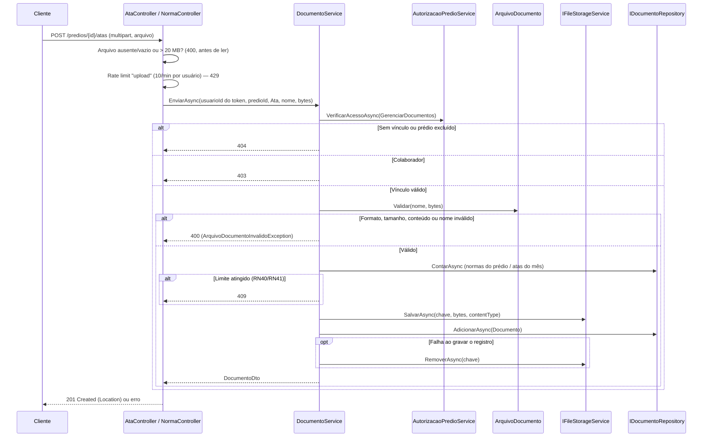

# Documentos (Atas e Normas) — Backend euSíndico

Este documento descreve o envio, a consulta, o download e a exclusão de atas de reunião e normas internas (RF22–RF25, RNF09, RNF10, RN05, RN12, RN37–RN39) do [RFC](../../documentation/RFC/RFC.md). Referência para `AtaController`/`NormaController`/`DocumentoService`/`DocumentoRepository`.

> **Status:** implementado — `POST`/`GET`/`GET {id}`/`GET {id}/download`/`DELETE {id}` em `/predios/{predioId}/atas` e `/predios/{predioId}/normas`. Sem migration: as tabelas `documentos` e `tipo_documento` (com "Atas" e "Normas" semeadas) já existiam desde a `InitialCreate`.

## Sumário

- [Visão geral](#visão-geral)
- [Onde cada peça mora na arquitetura](#onde-cada-peça-mora-na-arquitetura)
- [Regras de negócio aplicadas](#regras-de-negócio-aplicadas)
- [Endpoints](#endpoints)
- [Fluxo 1 — Enviar (RF22)](#fluxo-1--enviar-rf22)
- [Fluxo 2 — Listar (RF23)](#fluxo-2--listar-rf23)
- [Fluxo 3 — Obter](#fluxo-3--obter)
- [Fluxo 4 — Baixar (RF24)](#fluxo-4--baixar-rf24)
- [Fluxo 5 — Excluir (RF25)](#fluxo-5--excluir-rf25)
- [Validação do arquivo (RN12)](#validação-do-arquivo-rn12)
- [Armazenamento (S3)](#armazenamento-s3)
- [Segurança](#segurança)
- [Decisões confirmadas](#decisões-confirmadas)
- [Pendências](#pendências)
- [Testes](#testes)

## Visão geral

- Todo endpoint exige `[Authorize]`; `usuarioId` vem sempre da claim `sub` (RN02).
- **Uma rota por tipo**, porque o front tem uma tela para cada: `/predios/{predioId}/atas` e `/predios/{predioId}/normas`. Por baixo, um único `DocumentoService` e um `DocumentoControllerBase`; `AtaController` e `NormaController` só fixam o prefixo e o `TipoDocumentoPredio`.
- **Um documento só é alcançado pelo tipo com que foi enviado:** pedir uma ata pela rota de normas (ou o contrário) responde `404`, igual a um id inexistente.
- Autorização só por *vínculo e papel* (`AutorizacaoPredioService`): documento não tem dono individual (como planejamentos e relatórios).
- O arquivo vai para o S3 via `IFileStorageService` (o mesmo dos relatórios) e só os metadados ficam no MySQL. Nunca é exposto por URL pública: o download passa pela API.
- Sem edição: para trocar um arquivo, o usuário envia o novo e exclui o antigo.

## Onde cada peça mora na arquitetura

| Componente | Camada | Responsabilidade |
|---|---|---|
| `Documento`, `TipoDocumento` | Domain | Entidades já existentes. `Documento.UrlArquivo` guarda a **chave** do objeto no bucket, não uma URL. |
| `TipoDocumentoPredio` (`Ata = 1`, `Norma = 2`) | Domain | Enum com os ids semeados em `tipo_documento`; nunca renumerar. Um teste garante que o seed bate com o enum. |
| `IDocumentoRepository` / `DocumentoRepository` | Application / Infrastructure | `BuscarPorIdAsync`, `ListarAsync(predioId, tipo, nome, page, pageSize)`, `AdicionarAsync`, `RemoverAsync`. |
| `ArquivoDocumento` | Application | Valida nome, extensão, tamanho e conteúdo (RN12) e devolve o content type. |
| `ChaveDocumento` | Application | Formato da chave no S3 (`documentos/{predioId}/{guid}{ext}`) e o prefixo usado na exclusão de conta. |
| `DocumentoService` | Application | Casos de uso; aplica RN05, RN09, RN37–RN39. |
| `AcaoPredio.VisualizarDocumentos` / `GerenciarDocumentos` / `ExcluirDocumentos` | Application | Acrescentadas à matriz do `AutorizacaoPredioService` (ver [EQUIPE.md](EQUIPE.md)). |
| `DocumentoNaoEncontradoException` (`404`), `ArquivoDocumentoInvalidoException` (`400`) | Application | Mapeadas no `ApplicationExceptionHandler`. `PredioNaoEncontradoException` e `AcaoNaoPermitidaException` são reaproveitadas. |
| `DocumentoControllerBase`, `AtaController`, `NormaController` | Api | Rotas, paginação e leitura do `multipart/form-data`. |

## Regras de negócio aplicadas

| Regra | Como é aplicada |
|---|---|
| RN05/RN09 — documento vinculado a um prédio ativo | `AcessarPredioAsync` trata `Predio.Excluido` como "não existe" (`404`) em todas as operações; a listagem também filtra no repositório. |
| RN12 — PDF, DOCX, JPG, PNG, até 20 MB | `ArquivoDocumento.Validar` — ver [Validação do arquivo](#validação-do-arquivo-rn12). |
| RN16 — só com vínculo explícito | Todo acesso passa pelo vínculo do `predio_usuarios`. |
| RN37 — permissões | Síndico e Gestor enviam; os três papéis listam, consultam e baixam; só o Síndico exclui. |
| RN38 — arquivo e nome | Conteúdo confere com a extensão; nome sem caracteres proibidos. |
| RN39 — tipo, ordem e remoção | Tipo fixado pela rota; listagem do enviado mais recentemente para o mais antigo; exclusão física do registro e do arquivo. |
| RN40 — no máximo 10 normas por prédio | `VerificarLimiteAsync` conta as normas existentes do prédio; com 10, recusa com `409` (`LimiteNormasAtingidoException`). Excluir libera vaga. |
| RN41 — no máximo 5 atas por mês, por prédio | Conta as atas do prédio com `criado_em` dentro do mês corrente; com 5, recusa com `409` (`LimiteAtasMensalAtingidoException`). O mês é o do fuso `America/Sao_Paulo` (convertido para UTC, que é como `criado_em` é gravado). Excluir libera vaga; no dia 1º a contagem recomeça. |
| Rate limiting do envio | Política `upload`: 10 `POST` por minuto por usuário (claim `sub`), sem fila, `429`. Uma só contagem para atas e normas. Ver [Segurança](#segurança). |
| RNF10 — paginação | `page`/`pageSize` (padrão `1`/`10`, máx. `20`), fora da faixa → `400`, envelope `PagedResultDto<T>`. |

## Endpoints

Os mesmos cinco para `/predios/{predioId}/atas` e `/predios/{predioId}/normas`:

| Método | Rota | Ação | Sucesso | Erros possíveis |
|---|---|---|---|---|
| `POST` | `…/{atas\|normas}` | Enviar (RF22) — `multipart/form-data`, campo `arquivo` | `201` + `Location` | `400` (sem arquivo, formato, tamanho, conteúdo, nome), `403` (Colaborador), `404` (prédio), `409` (limite de normas ou de atas do mês, RN40/RN41), `413` (corpo acima do limite do servidor), `429` (mais de 10 envios por minuto) |
| `GET` | `…/{atas\|normas}` | Listar, paginado (RF23) | `200` | `400` (parâmetros), `404` |
| `GET` | `…/{atas\|normas}/{id}` | Metadados | `200` | `404` |
| `GET` | `…/{atas\|normas}/{id}/download` | Arquivo (RF24), `Content-Disposition: attachment` | `200` com o content type do arquivo | `404` |
| `DELETE` | `…/{atas\|normas}/{id}` | Excluir (RF25) — só Síndico | `204` | `403`, `404` |

Filtros do `GET` (opcionais): `nome` (trecho do nome do arquivo, até 255 caracteres), `page`, `pageSize`. Resposta (`DocumentoDto`): `id`, `nomeArquivo`, `predioId`, `predioNome`, `criadoEm`. A chave do objeto no S3 **não** é exposta.

Ordem da listagem: `criado_em DESC, id DESC` (o mais recente primeiro; o `id` desempata a paginação).

## Fluxo 1 — Enviar (RF22)

A permissão é conferida **antes** de validar o arquivo (quem não pode enviar não descobre as regras de validação), e o arquivo é validado **antes** de consultar o limite (a checagem barata vem primeiro). Contar e inserir não são atômicos: dois envios simultâneos do mesmo prédio podem passar do limite em um arquivo — aceito, como no limite de relatórios. A gravação é "arquivo primeiro, registro depois", como nos relatórios: se o registro falhar, o arquivo é removido para não ficar órfão; se o upload falhar, nenhum registro é criado — nunca existe linha apontando para um arquivo inexistente.

## Fluxo 2 — Listar (RF23)

`DocumentoService.ListarAsync`: confere vínculo (qualquer papel) e prédio ativo, repassa tipo e busca por nome ao repositório (busca em branco vira "sem filtro") e devolve o envelope paginado.

## Fluxo 3 — Obter

`GET …/{id}`: documento inexistente, de **outro prédio** ou de **outro tipo** devolvem a mesma resposta (`404` "Documento não encontrado") — o id não pode ser usado para alcançar um registro de um prédio, ou de uma tela, diferente do que o acesso checado cobre.

## Fluxo 4 — Baixar (RF24)

Mesmas checagens do Fluxo 3, depois `IFileStorageService.LerAsync(chave)`. Arquivo ausente no storage vira `404` (inconsistência, não `500`). O content type vem da extensão do nome gravado (nunca do que o cliente declarou no envio); o nome do download é o nome original do arquivo. O controller devolve `FileStreamResult`, que descarta o stream ao final da resposta.

## Fluxo 5 — Excluir (RF25)

`DELETE` (só Síndico): remove o registro e depois o arquivo no S3. Se apagar o arquivo falhar, a exclusão **não** vira erro (o registro já foi): fica um arquivo órfão e a chave é registrada no log. Não há lixeira.

## Validação do arquivo (RN12)

`ArquivoDocumento.Validar` roda no `DocumentoService` (regra de negócio, testável sem HTTP). O controller só recusa cedo, sem ler o arquivo: ausente, vazio ou acima de 20 MB. Ordem das checagens e mensagens ao usuário:

| Checagem | Rejeita quando | Mensagem |
|---|---|---|
| Nome | vazio, > 255 caracteres, começa com `.`, tem `< > " \` { } \| \ / : * ?` ou caractere de controle | "O nome do arquivo é inválido." |
| Extensão | fora de `.pdf .docx .jpg .jpeg .png` (sem diferenciar maiúsculas) | "Formato de arquivo não aceito. Envie PDF, DOCX, JPG ou PNG." |
| Vazio | 0 bytes | "O arquivo está vazio." |
| Tamanho | > 20 MB (20 × 1024 × 1024 bytes) | "O arquivo deve ter no máximo 20 MB." |
| Conteúdo | assinatura não bate com a extensão | "O conteúdo do arquivo não corresponde ao formato informado." |

Assinaturas: PDF `%PDF-`; JPG `FF D8 FF`; PNG `89 50 4E 47 0D 0A 1A 0A`; DOCX começa com a assinatura ZIP (`PK\x03\x04`) **e** contém `word/document.xml` — assim um `.docx` que na verdade é uma planilha, ou um ZIP qualquer renomeado, é recusado. XLSX e o `.doc` antigo não são aceitos: atas e normas não precisam de planilha, e o `.doc` (binário, pode ter macros) é mais difícil de validar que o `.docx`. Só o índice do ZIP é lido, nunca o conteúdo comprimido (sem risco de "zip bomb").

`.jpeg` é aceito junto de `.jpg` (mesmo formato). O arquivo não é varrido por antivírus nem reprocessado: a validação garante que *é* do formato declarado, não que seja inofensivo — por isso o download é sempre como anexo.

## Armazenamento (S3)

- **Chave:** `documentos/{predioId}/{guid}{extensão}` — só ids, um guid e a extensão já validada; o nome do usuário nunca entra na chave (sem path traversal, sem colisão). O nome original fica em `nome_arquivo`.
- **Privado e criptografado:** o bucket não tem URL pública; objetos gravados com `ServerSideEncryptionMethod.AES256` (mesma implementação dos relatórios, `S3FileStorageService`). Atas e normas dividem o prefixo `documentos/{predioId}/`.
- **Configuração e IAM:** as mesmas de [RELATORIOS.md](RELATORIOS.md#armazenamento-s3) — a política da role precisa cobrir também `documentos/*` (e a condição `s3:prefix` do `ListBucket`).
- **Exclusão de conta de Síndico:** depois de a transação do banco confirmar, `PerfilService` chama `RemoverPrefixoAsync("documentos/{predioId}/")` para cada prédio apagado, ao lado do prefixo de relatórios; cada prefixo é tentado de forma independente e a falha de um não impede o outro nem a exclusão da conta (vai para o log como arquivo órfão). O registro em `documentos` já é apagado pela transação do banco.
- **Upload em memória:** o arquivo (até 20 MB) é lido inteiro para validar a assinatura e enviado ao S3 como `byte[]`. Adequado à escala do projeto (RNF07); se a carga crescer, a evolução natural é validar só o cabeçalho e enviar em stream.

## Segurança

- **Autorização (RN01/RN16):** `[Authorize]`; `usuarioId` da claim; vínculo e papel checados antes de qualquer leitura ou escrita.
- **IDOR / anti-enumeração:** documento inexistente, de outro prédio, de outro tipo, de prédio sem vínculo ou excluído → mesmo `404`. `403` só para quem já é membro (Colaborador tentando enviar; Gestor/Colaborador tentando excluir).
- **Arquivo nunca público (RNF09, RFC 6.1):** download pela API autenticada, sempre revalidando o vínculo. Resposta como anexo (`Content-Disposition: attachment`) com `X-Content-Type-Options: nosniff` — o navegador nunca renderiza um arquivo do usuário (inclusive imagem/PDF) no contexto da API.
- **Não confia no cliente:** nem `Content-Type` nem só a extensão; o conteúdo é conferido (ver acima).
- **Nome do arquivo (XSS/path traversal):** rejeitado, não sanitizado — mesma linha dos demais campos ([SECURITY.md](SECURITY.md), seção 3). O front exibe o nome pelo escape padrão do Vue.
- **Rate limiting do envio:** política `upload` (`Program.cs`), 10 requisições por minuto, janela fixa, sem fila, resposta `429` no formato mínimo. A partição é o **usuário** (claim `sub`), não o IP: independe do `ForwardedHeaders` do App Runner (pendência do [SECURITY.md](SECURITY.md), seção 12) e não pune quem divide o mesmo IP. O IP só serve de reserva se não houver claim. Atas e normas dividem a mesma contagem. Conta toda tentativa, inclusive as recusadas por arquivo inválido. Os limites de quantidade (RN40/RN41) são outra camada, sobre o que fica guardado; o rate limit só contém rajadas. Como o contador fica na memória da instância, com várias instâncias do App Runner o limite efetivo é por instância (mesma ressalva do rate limit de login).
- **Limite de corpo:** `[RequestSizeLimit]` de 21 MB no `POST` corta cedo requisições maiores (o Kestrel responde `413`); o limite exato de 20 MB do arquivo é conferido em seguida.
- **Erro mínimo:** `ProblemDetails` só com `Status`/`Title`.

## Decisões confirmadas

Pontos que o RFC não especificava, validados antes de implementar:

1. **Permissões:** iguais às de planejamentos, para atas e normas — Síndico e Gestor enviam; os três papéis visualizam e baixam; só o Síndico exclui.
2. **Rotas:** duas separadas, `/predios/{id}/atas` e `/predios/{id}/normas`, com o tipo fixado pela rota.
3. **Metadados:** só os previstos no RFC (nome do arquivo, tipo, prédio, data de criação) — sem título nem data de reunião.
4. **Listagem:** paginada, busca por trecho do nome, mais recentes primeiro.
5. **Upload:** `multipart/form-data` pela API, validando extensão, tamanho e assinatura do arquivo.
6. **Formatos:** PDF, DOCX, JPG e PNG — XLSX removido (atas e normas não usam planilhas); `.doc` antigo segue recusado.
7. **Limites de quantidade:** no máximo 10 normas por prédio (RN40) e 5 atas por mês por prédio (RN41), ambos contando os documentos existentes (excluir libera vaga); a ata é contada pelo mês de envio, sem campo de data da reunião.
8. **Rate limiting:** 10 envios por minuto por usuário.

Escolhas de implementação (não perguntadas, seguem o padrão dos módulos anteriores): `.jpeg` aceito como JPG; `400` para todo erro de arquivo (formato, tamanho, conteúdo, nome) e `409` para limite de quantidade; nomes repetidos são permitidos (cada envio é um documento novo, sem substituição); sem edição/renomeação; limites fixos no código (`DocumentoService.LimiteNormasPorPredio` e `LimiteAtasPorMes`), não configuráveis.

## Pendências

- **Sem teste contra S3 real:** `S3FileStorageService` é compartilhada com os relatórios e segue sem teste automatizado; validar manualmente com um bucket antes do deploy (envio, download e exclusão de uma ata e de uma norma).
- **Sem teste de integração contra MySQL real** (SQLite em memória, mesma ressalva de [RELATORIOS.md](RELATORIOS.md)).
- **Sem antivírus:** ver [Validação do arquivo](#validação-do-arquivo-rn12). Se o produto passar a aceitar documentos de terceiros, avaliar uma varredura (ex.: um passo assíncrono antes de liberar o download).
- **Política do bucket:** confirmar que a role cobre `documentos/*` (acima) — sem isso o envio responde `500`.

## Testes

Convenção do projeto: `Metodo_condicao_resultado`, `Moq`.

- `euSindico.Application.Tests/Documentos/DocumentoServiceTests.cs` — permissões por papel, tipo gravado, chave sem o nome do usuário, arquivo inválido, rollback do arquivo quando o registro falha, nenhum registro quando o upload falha, prédio excluído, outro prédio, outro tipo, arquivo ausente, exclusão com falha no storage. Usa `InMemoryFileStorageService`.
- `euSindico.Application.Tests/Documentos/ArquivoDocumentoTests.cs` — cada formato aceito, extensão recusada, limite de 20 MB (exato e acima), vazio, conteúdo que não bate com a extensão, DOCX que na verdade é planilha, XLSX recusado, ZIP qualquer e corrompido, nomes inválidos e válidos.
- `euSindico.Application.Tests/Documentos/ChaveDocumentoTests.cs` — prefixo com barra final e chave única sob o prefixo.
- `euSindico.Application.Tests/Equipe/AutorizacaoPredioServiceTests.cs` — `VisualizarDocumentos`/`GerenciarDocumentos`/`ExcluirDocumentos` por papel.
- `euSindico.Application.Tests/Auth/PerfilServiceTests.cs` — exclusão de conta limpa os prefixos de relatórios e de documentos de cada prédio, e a falha de um não impede o outro.
- `euSindico.Api.Tests/Controllers/DocumentoControllerTests.cs` — as duas rotas (tipo gravado e filtrado), status codes, limites de paginação, arquivo ausente/vazio/grande, download como anexo com `nosniff`.
- `euSindico.Application.Tests/Documentos/DocumentoServiceTests.cs` (seção "Limites") — 9 × 10 normas, 4 × 5 atas, recorte do mês no fuso (inclusive virada de mês às 22h locais e dezembro → janeiro), norma não afeta ata, arquivo inválido recusado antes de consultar o limite.
- `euSindico.Api.Tests/Middleware/ApplicationExceptionHandlerTests.cs` — as exceções novas (inclusive os dois `409` de limite e o `413`).
- `euSindico.Api.Tests/RateLimitingTests.cs` — 10 envios passam e o 11º recebe `429`; a contagem é por usuário (outro usuário no mesmo IP não é afetado) e vale para atas e normas juntas.
- `euSindico.Infrastructure.Tests/Persistence/DocumentoRepositoryTests.cs` — SQLite em memória: seed dos tipos × enum, ordem, filtro por tipo e por nome, paginação, prédio excluído, remoção, contagem por prédio/tipo e por intervalo (início incluído, fim excluído), vaga liberada ao remover.
