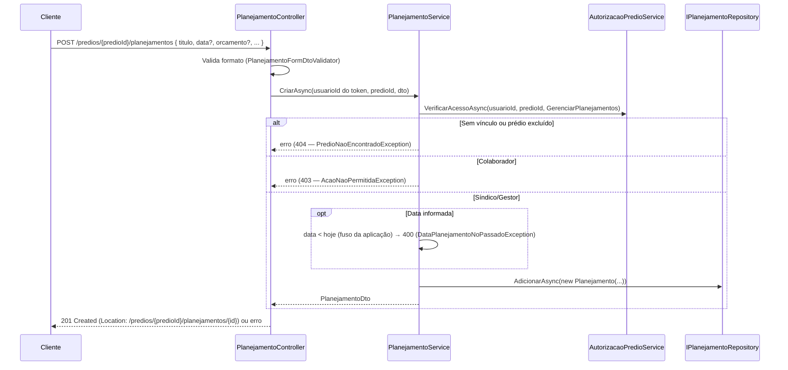

# Planejamentos futuros — Backend euSíndico

Este documento descreve o CRUD de planejamentos futuros (RF18–RF21, RNF10, RN04, RN09, RN11, RN29–RN32) do [RFC](../../documentation/RFC/RFC.md). Referência para `PlanejamentoController`/`PlanejamentoService`/`PlanejamentoRepository`.

> **Status:** implementado — `POST`/`GET`/`GET {id}`/`PUT`/`DELETE /predios/{predioId}/planejamentos`. Sem migration nova: a tabela `planejamentos` já existia desde a `InitialCreate`.

## Sumário

- [Visão geral](#visão-geral)
- [Onde cada peça mora na arquitetura](#onde-cada-peça-mora-na-arquitetura)
- [Entidade Planejamento](#entidade-planejamento)
- [Regras de negócio aplicadas](#regras-de-negócio-aplicadas)
- [Endpoints](#endpoints)
- [Listagem: filtros e ordenação](#listagem-filtros-e-ordenação)
- [Fluxo 1 — Criar (RF18)](#fluxo-1--criar-rf18)
- [Fluxo 2 — Listar (RF19)](#fluxo-2--listar-rf19)
- [Fluxo 3 — Obter](#fluxo-3--obter)
- [Fluxo 4 — Editar (RF20)](#fluxo-4--editar-rf20)
- [Fluxo 5 — Remover (RF21)](#fluxo-5--remover-rf21)
- [Validação de entrada e sanitização](#validação-de-entrada-e-sanitização)
- [Fuso horário](#fuso-horário)
- [Exclusão de conta](#exclusão-de-conta)
- [Segurança](#segurança)
- [Decisões confirmadas](#decisões-confirmadas)
- [Pendências](#pendências)
- [Testes](#testes)

## Visão geral

- Todo endpoint exige `[Authorize]`; `usuarioId` vem sempre da claim `sub`, nunca do corpo ou da rota (RN02).
- **Rotas aninhadas no prédio:** `/predios/{predioId}/planejamentos`. Diferente de compromissos (rota única `/compromissos`), planejamento só faz sentido dentro de um prédio (RN04) e não há tela global — então não existe listagem entre prédios, e o prédio nunca vem do corpo.
- **Autorização:** vínculo com o prédio via `AutorizacaoPredioService` e prédio não excluído (RN09). Síndico e Gestor têm CRUD completo; o **Colaborador só lê** (`GET`) — criar, editar e remover devolvem `403`. Não existe "posse" de planejamento (não há responsável), então a decisão é só por papel.
- **Sem conclusão e sem responsável:** planejamento nunca é "concluído" (RN11) — é uma intenção futura, não uma tarefa.
- **Data opcional, mas nunca no passado** (RN11, RN30).
- **Remoção física** (sem `excluido`), como compromissos (RN25).
- **Não muda de prédio:** o `PUT` não aceita `predioId`.

## Onde cada peça mora na arquitetura

| Componente | Camada | Responsabilidade |
|---|---|---|
| `Planejamento` | Domain | Entidade (já existia); `AtualizarDados`. |
| `PlanejamentoConfiguration` | Infrastructure | Tabela `planejamentos`, FK `Restrict` para prédio (já existia). |
| `IPlanejamentoRepository` / `PlanejamentoRepository` | Application / Infrastructure | `BuscarPorIdAsync`, `ListarAsync(PlanejamentoFiltro, page, pageSize)`, `AdicionarAsync`, `AtualizarAsync`, `RemoverAsync`. |
| `PlanejamentoService` | Application | Casos de uso; aplica RN09, RN30; resolve "hoje" pelo `TimeProvider`. |
| `AcaoPredio.VisualizarPlanejamentos`, `AcaoPredio.GerenciarPlanejamentos` | Application | Acrescentadas à matriz do `AutorizacaoPredioService`. |
| `PlanejamentoFiltro` | Application | Parâmetros da listagem. |
| `PlanejamentoFormDto`, `PlanejamentoDto` | Application | Entrada (criar/editar) e saída. |
| `PlanejamentoNaoEncontradoException` (`404`), `DataPlanejamentoNoPassadoException` (`400`) | Application | Mapeadas no `ApplicationExceptionHandler`. `PredioNaoEncontradoException` e `AcaoNaoPermitidaException` são **reaproveitadas**. |
| `PlanejamentoController` | Api | Rotas, validação de entrada e dos parâmetros de listagem. |
| `PlanejamentoFormDtoValidator` | Api | Validação de formato; reaproveita `TituloValidator`, `PrestadorServicoValidator` e `DetalhesValidator`. |

## Entidade Planejamento

```csharp
public class Planejamento
{
    public int Id { get; private set; }
    public string Titulo { get; private set; }
    public DateOnly? DataPlanejamento { get; private set; }      // opcional — RN11
    public decimal? OrcamentoPrevisto { get; private set; }      // opcional, decimal(10,2)
    public string? NomePrestadorServico { get; private set; }
    public string? Detalhes { get; private set; }
    public int PredioId { get; private set; }
    public DateTime CriadoEm { get; private set; }

    public Predio? Predio { get; private set; }
}
```

Nada mudou na entidade nem no esquema. A tabela `planejamentos` só tem o índice de FK em `predio_id` (gerado pelo EF); a listagem sempre filtra por um único prédio, então esse índice basta para o volume esperado.

## Regras de negócio aplicadas

| Regra | Como é aplicada |
|---|---|
| RN04 — planejamento sempre vinculado a um prédio | O `predioId` vem da rota e é checado contra o vínculo do usuário. |
| RN09 — prédio excluído não aceita cadastro/edição | `AcessarPredioAsync` trata `Predio.Excluido` como "não existe" (`404`) em todas as operações, inclusive leitura. |
| RN08 (leitura) — prédio excluído some das telas | A listagem filtra `!Predio.Excluido`; obter por id devolve `404`. |
| RN11 — pode ficar sem data e nunca é concluído | `DateOnly?` no DTO e na entidade; não há campo nem endpoint de conclusão. |
| RN16 — só com vínculo explícito | Toda operação passa pelo vínculo do `predio_usuarios`. |
| RN29 — Colaborador só lê | Ver [Segurança](#segurança). |
| RN30 — data hoje ou futura | Ver [Fuso horário](#fuso-horário). |
| RN31 — ordenação | Ver [Listagem](#listagem-filtros-e-ordenação). |
| RN32 — remoção física | `PlanejamentoRepository.RemoverAsync`. |
| RNF10 — paginação | `page`/`pageSize` (padrão `1`/`10`, `pageSize` máx. `20`), fora da faixa → `400`, mesmo envelope `PagedResultDto<T>` de [PREDIOS.md](PREDIOS.md). |

## Endpoints

| Método | Rota | Ação | Papéis | Sucesso | Erros possíveis |
|---|---|---|---|---|---|
| `POST` | `/predios/{predioId}/planejamentos` | Criar (RF18) | Síndico, Gestor | `201` + `Location` | `400`, `403`, `404` (prédio) |
| `GET` | `/predios/{predioId}/planejamentos` | Listar, paginado (RF19) | todos | `200` | `400` (parâmetros), `404` (prédio) |
| `GET` | `/predios/{predioId}/planejamentos/{id}` | Detalhes | todos | `200` | `404` |
| `PUT` | `/predios/{predioId}/planejamentos/{id}` | Editar (RF20) | Síndico, Gestor | `200` | `400`, `403`, `404` |
| `DELETE` | `/predios/{predioId}/planejamentos/{id}` | Remover (RF21) | Síndico, Gestor | `204` | `403`, `404` |

Corpo de `POST`/`PUT` (`PlanejamentoFormDto`):

```json
{
  "titulo": "Pintura da fachada",
  "dataPlanejamento": "2026-12-01",
  "orcamentoPrevisto": 15000.50,
  "nomePrestadorServico": "Tintas Ltda.",
  "detalhes": "Cotar três orçamentos antes de decidir."
}
```

Só `titulo` é obrigatório. `dataPlanejamento`, `orcamentoPrevisto`, `nomePrestadorServico` e `detalhes` são opcionais — e, no `PUT`, omitir um campo **o limpa** (o corpo é o estado completo desejado, como em compromissos). Resposta (`PlanejamentoDto`): os mesmos campos mais `id`, `predioId`, `predioNome` e `criadoEm`.

## Listagem: filtros e ordenação

`GET /predios/{predioId}/planejamentos` aceita, todos opcionais e combináveis:

| Parâmetro | Valores | Padrão | Observação |
|---|---|---|---|
| `titulo` | texto (máx. 150) | — | Busca por trecho no título. |
| `orcamentoMinimo` | decimal `>= 0` | — | Inclusivo. |
| `orcamentoMaximo` | decimal `>= 0` | — | Inclusivo. Menor que `orcamentoMinimo` → `400`. |
| `page`, `pageSize` | `>= 1`, `1..20` | `1`, `10` | RNF10. |

**Planejamento sem orçamento nunca casa com a faixa.** Basta informar `orcamentoMinimo` **ou** `orcamentoMaximo` para os sem orçamento saírem da lista; a comparação de `NULL` com um número nunca é verdadeira. Sem nenhum dos dois, eles aparecem normalmente.

**Ordenação (RN31):** primeiro os **com data**, da mais distante para a mais próxima (data decrescente); depois os **sem data**. Dentro de cada grupo, e como desempate na mesma data, o cadastrado mais recentemente vem antes (`criado_em` decrescente), e por fim `id` decrescente para a paginação ser estável. Diferente de compromissos (RN14, cronológico crescente): aqui o topo da lista é o que está mais longe no futuro.

## Fluxo 1 — Criar (RF18)



`Titulo`, `NomePrestadorServico` e `Detalhes` levam `.Trim()` no Service; opcionais vazios ou só com espaços viram `null`.

## Fluxo 2 — Listar (RF19)

`PlanejamentoService.ListarAsync`: confere vínculo e prédio ativo (`VisualizarPlanejamentos`, qualquer papel; `404` caso contrário), monta o `PlanejamentoFiltro` com o `titulo` normalizado e delega ao repositório. O repositório também filtra `!Predio.Excluido`.

## Fluxo 3 — Obter

`GET /predios/{predioId}/planejamentos/{id}`: o acesso ao **prédio da rota** é checado primeiro; só depois o planejamento é carregado. Planejamento inexistente **ou de outro prédio** devolve `404` "Planejamento não encontrado" — o id só vale dentro do prédio da rota, mesmo que o usuário também tenha acesso ao outro prédio.

## Fluxo 4 — Editar (RF20)

`PUT` usa o mesmo `PlanejamentoFormDto` da criação. Ordem das checagens: (1) acesso de gerenciar ao prédio — Colaborador → `403`; (2) planejamento existe naquele prédio — senão `404`; (3) data não está no passado — senão `400`. O planejamento não muda de prédio.

**A regra da data vale em toda edição**, mesmo que a data não tenha mudado. Consequência aceita: um planejamento cuja data já passou não pode mais ter nem o título corrigido sem antes trocar a data por uma de hoje em diante ou limpá-la (a data é opcional, RN11).

## Fluxo 5 — Remover (RF21)

`DELETE` → exclusão física, `204`. Mesmas checagens do `PUT` (1 e 2).

## Validação de entrada e sanitização

Mesma estratégia de duas camadas de [SECURITY.md](SECURITY.md) (seção 3): allowlist como defesa em profundidade, escape do Vue como defesa primária. Reaproveita os validators de [COMPROMISSOS.md](COMPROMISSOS.md#validação-de-entrada-e-sanitização).

| Campo | Validator | Regra |
|---|---|---|
| `Titulo` | `TituloValidator` | Obrigatório, máx. 150, mesma allowlist de compromissos. |
| `NomePrestadorServico` | `PrestadorServicoValidator` | Opcional; quando preenchido, máx. 150 e a mesma allowlist. |
| `Detalhes` | `DetalhesValidator` | Opcional; máx. 2000, rejeita `<` e `>`. |
| `OrcamentoPrevisto` | `PlanejamentoFormDtoValidator` | Opcional; `>= 0` (zero é válido), `<= 99.999.999,99` (cabe em `decimal(10,2)`), no máximo 2 casas decimais. |
| `DataPlanejamento` | `PlanejamentoService` | Opcional; quando informada, hoje ou futura — ver [Fuso horário](#fuso-horário). |

Mais de 2 casas decimais são **rejeitadas** com `400`, em vez de arredondadas: o banco arredondaria em silêncio e o usuário veria um valor diferente do que digitou. **Mass assignment:** o DTO não expõe `Id`, `PredioId` (vem da rota) nem `CriadoEm`. Os parâmetros de listagem também são validados (`400` para `page`/`pageSize` fora da faixa, `titulo` > 150, orçamentos negativos e `orcamentoMinimo > orcamentoMaximo`).

## Fuso horário

A regra "hoje ou futura" precisa saber que dia é **agora no Brasil**, e o servidor roda em UTC — entre 21h e 24h em Brasília, "hoje" em UTC já seria o dia seguinte e um planejamento para hoje seria rejeitado por engano. Por isso a regra mora no `PlanejamentoService` (que recebe o `TimeProvider`, o mesmo `FusoHorarioTimeProvider` de compromissos, [COMPROMISSOS.md](COMPROMISSOS.md#fuso-horário)), e não no validator, que não conhece o fuso.

## Exclusão de conta

`UsuarioRepository.ExcluirUsuarioEDadosRelacionadosAsync` (RF07) já removia os planejamentos dos prédios do Síndico antes dos prédios (FK `Restrict`) — coberto agora por teste de repositório com FKs ativas. Funcionário não tem planejamentos próprios (não há responsável), então a exclusão da conta dele não toca neles.

## Segurança

- **Autorização (RN01/RN16/RN29):** `[Authorize]` no controller; `usuarioId` da claim `sub`; todo acesso passa pelo vínculo do prédio e pela matriz do `AutorizacaoPredioService`. O Colaborador só lê — decidido no backend, não depende de o front esconder botões.
- **IDOR / anti-enumeração:** sem vínculo, prédio excluído e prédio inexistente → mesmo `404`. Planejamento de outro prédio → `404` (não `403`). `403` só aparece quando o usuário já é membro do prédio (Colaborador tentando escrever).
- **XSS:** allowlist em título/prestador, bloqueio de `<`/`>` em detalhes; defesa primária é o escape do Vue.
- **SQL Injection:** EF Core parametrizado (a busca por título usa `Contains`).
- **Rate limiting:** não aplicado, mesma justificativa de [PREDIOS.md](PREDIOS.md).
- **Erro mínimo:** `ProblemDetails` só com `Status`/`Title`.

## Decisões confirmadas

Pontos que o RFC não especificava, validados antes de implementar:

1. **Colaborador:** somente leitura (listar e obter); criar, editar e remover → `403`. A matriz anterior do [EQUIPE.md](EQUIPE.md) marcava planejamentos como ❌ para ele; foi alterada.
2. **Rotas:** aninhadas em `/predios/{predioId}/planejamentos`, sem listagem global.
3. **Ordenação:** data decrescente (mais recente primeiro); sem data no fim, ordenados por `criado_em` decrescente.
4. **Filtros:** `titulo` e faixa de orçamento (`orcamentoMinimo`/`orcamentoMaximo`), paginado.
5. **Data no passado:** **não** permitida (diferente de compromissos, RN26).
6. **Data na edição:** validada sempre, não só quando muda.
7. **Mover de prédio:** não permitido.
8. **Remoção:** física.
9. **Orçamento:** aceita zero; máximo de `99.999.999,99`.
10. **Detalhe de implementação, não perguntado:** mais de 2 casas decimais no orçamento são rejeitadas em vez de arredondadas.

## Pendências

- **Ver planejamentos de todos os prédios numa tela só** — hoje cada prédio é consultado isoladamente (decisão 2).
- **Sem teste de integração contra MySQL real.** Os testes de repositório rodam em SQLite em memória — cobrem ordenação, filtros e exclusão com FKs ativas, mas a tradução de `Contains` difere (maiúsculas/minúsculas) entre os provedores. Gap já conhecido no projeto ([PREDIOS.md](PREDIOS.md)).
- **Planejamento vencido fica "congelado"** até a data ser trocada ou limpada (decisão 6). Se virar atrito na tela, a alternativa é validar a data só quando ela mudar.

## Testes

Convenção do projeto: `Metodo_condicao_resultado`, `Moq`, `TestValidate` para validators.

- `euSindico.Domain.Tests/PlanejamentoTests.cs`
- `euSindico.Application.Tests/Planejamentos/PlanejamentoServiceTests.cs` — papéis (Colaborador só lê), prédio excluído (RN09), planejamento de outro prédio, data no fuso configurado, data validada mesmo sem mudar, normalização.
- `euSindico.Application.Tests/Equipe/AutorizacaoPredioServiceTests.cs` — `VisualizarPlanejamentos` e `GerenciarPlanejamentos` por papel.
- `euSindico.Api.Tests/Controllers/PlanejamentoControllerTests.cs` — status codes, limites de paginação, faixa de orçamento inválida.
- `euSindico.Api.Tests/Validators/PlanejamentoFormDtoValidatorTests.cs`
- `euSindico.Api.Tests/Middleware/ApplicationExceptionHandlerTests.cs` — as duas exceções novas.
- `euSindico.Infrastructure.Tests/Persistence/PlanejamentoRepositoryTests.cs` — SQLite em memória: ordenação com e sem data, faixa de orçamento inclusiva, isolamento por prédio, prédio excluído e exclusão de conta com FKs ativas.
