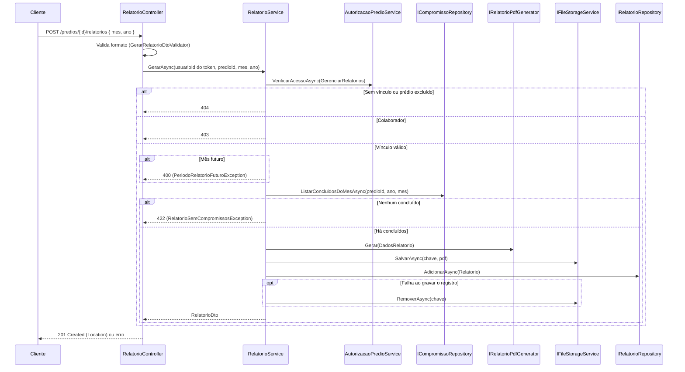

# Relatórios — Backend euSíndico

Este documento descreve a geração de relatórios mensais de compromissos (RF26–RF28, RNF09, RNF10, RN06, RN13, RN14, RN33–RN35) do [RFC](../../documentation/RFC/RFC.md). Referência para `RelatorioController`/`RelatorioService`/`RelatorioRepository`.

> **Status:** implementado — `POST`/`GET`/`GET {id}`/`GET {id}/download` em `/predios/{predioId}/relatorios`. Sem migration: a tabela `relatorios` já existia desde a `InitialCreate`.

## Sumário

- [Visão geral](#visão-geral)
- [Onde cada peça mora na arquitetura](#onde-cada-peça-mora-na-arquitetura)
- [Regras de negócio aplicadas](#regras-de-negócio-aplicadas)
- [Endpoints](#endpoints)
- [Fluxo 1 — Gerar (RF26)](#fluxo-1--gerar-rf26)
- [Fluxo 2 — Listar (RF27)](#fluxo-2--listar-rf27)
- [Fluxo 3 — Obter](#fluxo-3--obter)
- [Fluxo 4 — Baixar (RF28)](#fluxo-4--baixar-rf28)
- [Conteúdo do PDF](#conteúdo-do-pdf)
- [Armazenamento (S3)](#armazenamento-s3)
- [Segurança](#segurança)
- [Decisões confirmadas](#decisões-confirmadas)
- [Pendências](#pendências)
- [Testes](#testes)

## Visão geral

- Todo endpoint exige `[Authorize]`; `usuarioId` vem sempre da claim `sub` (RN02).
- **Rotas aninhadas no prédio** (`/predios/{predioId}/relatorios`), como Planejamentos: relatório é sempre de um prédio e não há listagem global.
- Autorização só por *vínculo e papel* (`AutorizacaoPredioService`): relatório não tem dono individual.
- **Cada geração cria um novo registro e um novo PDF** — o histórico é preservado (RN33).
- O PDF é gerado com **QuestPDF** na Application, gravado no S3 via `IFileStorageService` e só os metadados ficam no MySQL. O arquivo nunca é exposto por URL pública: o download passa pela API.

## Onde cada peça mora na arquitetura

| Componente | Camada | Responsabilidade |
|---|---|---|
| `Relatorio` | Domain | Entidade já existente (`MesReferencia`, `AnoReferencia`, `NomeArquivo`, `UrlArquivo`, `PredioId`, `GeradoEm`). `UrlArquivo` guarda a **chave** do objeto no bucket, não uma URL. |
| `IRelatorioRepository` / `RelatorioRepository` | Application / Infrastructure | `BuscarPorIdAsync`, `ListarAsync(predioId, ano, mes, page, pageSize)`, `AdicionarAsync`. |
| `ICompromissoRepository.ListarConcluidosDoMesAsync` | Application / Infrastructure | Concluídos do prédio no mês/ano, ordem cronológica, com o responsável carregado. |
| `IFileStorageService` / `S3FileStorageService` | Application / Infrastructure | `SalvarAsync`, `LerAsync`, `RemoverAsync`. Reaproveitável pelo módulo de Documentos. |
| `IRelatorioPdfGenerator` / `RelatorioPdfGenerator` | Application | Recebe `DadosRelatorio` (já ordenado) e devolve os bytes do PDF. Interface para o serviço ser testável sem renderizar. |
| `RelatorioService` | Application | Casos de uso; aplica RN09, RN33–RN35; resolve "agora" pelo `TimeProvider`. |
| `AcaoPredio.VisualizarRelatorios` / `GerenciarRelatorios` | Application | Acrescentadas à matriz do `AutorizacaoPredioService`. |
| `RelatorioNaoEncontradoException` (`404`), `PeriodoRelatorioFuturoException` (`400`), `RelatorioSemCompromissosException` (`422`) | Application | Mapeadas no `ApplicationExceptionHandler`. `PredioNaoEncontradoException` e `AcaoNaoPermitidaException` são reaproveitadas. |
| `RelatorioController`, `GerarRelatorioDtoValidator` | Api | Rotas e validação de entrada. |
| `S3Options` | Infrastructure | Seção `S3` (`BucketName`, `Region`). |

## Regras de negócio aplicadas

| Regra | Como é aplicada |
|---|---|
| RN05/RN09 — prédio excluído não aceita relatório | `AcessarPredioAsync` trata `Predio.Excluido` como "não existe" (`404`) em todas as operações. |
| RN06 — só concluídos | `ListarConcluidosDoMesAsync` filtra `concluido = true`. |
| RN13 — PDF, agrupando os concluídos do mês/ano | Ver [Conteúdo do PDF](#conteúdo-do-pdf). |
| RN14 — ordem cronológica crescente | `ORDER BY data, horario, id` na consulta do relatório. |
| RN16 — só com vínculo explícito | Todo acesso passa pelo vínculo do `predio_usuarios`. |
| RN33 — histórico | Sem unicidade em `(predio, mês, ano)`; cada `POST` cria uma nova linha e um novo arquivo. |
| RN34 — período | Mês/ano devem ser ≤ mês corrente no fuso `America/Sao_Paulo`; o mês corrente gera relatório parcial. |
| RN35 — permissões | Síndico e Gestor geram; os três papéis listam, consultam e baixam. |
| RNF10 — paginação | `page`/`pageSize` (padrão `1`/`10`, máx. `20`), fora da faixa → `400`, envelope `PagedResultDto<T>`. |

## Endpoints

| Método | Rota | Ação | Sucesso | Erros possíveis |
|---|---|---|---|---|
| `POST` | `/predios/{predioId}/relatorios` | Gerar (RF26) — corpo `{ "mes": 9, "ano": 2026 }` | `201` + `Location` | `400` (corpo ou mês futuro), `403` (Colaborador), `404` (prédio), `422` (sem concluídos) |
| `GET` | `/predios/{predioId}/relatorios` | Listar, paginado (RF27) | `200` | `400` (parâmetros), `404` |
| `GET` | `/predios/{predioId}/relatorios/{id}` | Metadados | `200` | `404` |
| `GET` | `/predios/{predioId}/relatorios/{id}/download` | PDF (RF28), `Content-Disposition: attachment` | `200` `application/pdf` | `404` |
| `DELETE` | `/predios/{predioId}/relatorios/{id}` | Excluir (RN36) — só Síndico | `204` | `403`, `404` |

`POST` também responde `409` quando o prédio já tem 3 relatórios do mês/ano pedido (RN36): *"O limite de 3 relatórios por mês foi atingido para este prédio e período. Exclua um relatório existente para gerar outro."*

Filtros do `GET` (opcionais): `ano` (`>= 1`) e `mes` (`1..12`). Resposta (`RelatorioDto`): `id`, `mesReferencia`, `anoReferencia`, `nomeArquivo`, `predioId`, `predioNome`, `geradoEm`. A chave do objeto no S3 **não** é exposta.

Ordem da listagem: `gerado_em DESC, id DESC` (o mais recente primeiro; o `id` desempata a paginação).

## Fluxo 1 — Gerar (RF26)

A gravação é "arquivo primeiro, registro depois": se o registro falhar, o arquivo é removido para não ficar órfão. Se o upload falhar, nenhum registro é criado — nunca existe linha apontando para um arquivo inexistente.

## Fluxo 2 — Listar (RF27)

`RelatorioService.ListarAsync`: confere vínculo (qualquer papel) e prédio ativo, repassa `ano`/`mes` ao repositório e devolve o envelope paginado.

## Fluxo 3 — Obter

`GET .../{id}`: relatório inexistente e relatório de **outro prédio** devolvem a mesma resposta (`404` "Relatório não encontrado") — o id não pode ser usado para alcançar um registro de um prédio diferente do que o acesso checado cobre.

## Fluxo 4 — Baixar (RF28)

Mesmas checagens do Fluxo 3, depois `IFileStorageService.LerAsync(chave)`. Arquivo ausente no storage vira `404` (inconsistência, não `500`). O controller devolve `FileStreamResult`, que descarta o stream ao final da resposta. O S3 impl copia o objeto para memória (PDFs de relatório são pequenos) para descartar a resposta do SDK dentro da própria chamada.

## Fluxo 5 — Excluir e limite de gerações (RN36)

- **Limite:** antes de gerar, `ContarAsync(predio, ano, mes) >= 3` → `409` (`LimiteRelatoriosAtingidoException`). Conta o **mês de referência** do relatório, não o de geração. A checagem vem depois do acesso e do período futuro e antes de ler compromissos/gerar PDF.
- **Excluir** (`DELETE`, só Síndico): remove o registro e depois o arquivo no S3. Se apagar o arquivo falhar, a exclusão **não** vira erro (o registro já foi): fica um arquivo órfão e a chave é registrada no log. Excluir libera uma vaga do limite — consequência aceita: excluir e gerar de novo contorna o limite, mas quem faz isso é o próprio síndico.
- **Corrida:** contar e inserir não são atômicos; duas gerações simultâneas do mesmo período podem passar de 3. Aceito (uso por poucos usuários, impacto só um PDF a mais).

## Conteúdo do PDF

Páginas A4, na ordem: título **"Relatório de atividades"** (azul); **Nome do prédio** e **Endereço**; **Compromissos concluídos no período de** (`Setembro de 2026`) e **Gerado em** (fuso da aplicação); **Total de compromissos concluídos**; depois, entre traços divisores azuis, um bloco por compromisso em ordem cronológica — **Título**, **Data** (data e horário), **Responsável**, **Prestador de serviço** e **Detalhes** (os dois últimos só quando preenchidos). No canto superior direito de toda página, "Arquivo gerado pelo sistema euSíndico"; rodapé com "Página X de Y". Fonte Times New Roman, tamanho 12 (título 20; cabeçalho e rodapé 9); margem de 40 pontos (cerca de 1,4 cm) nos quatro lados. Rótulos em negrito e texto preto; o azul da marca (`#1E4FA8`, de `vuetify.ts`) fica só no título e nos divisores. Um compromisso não é cortado entre páginas. Sem agrupamento por dia. O nome do arquivo baixado é `{NomeDoPredio}_Relatorio_{AAAA-MM}.pdf`, com o nome do prédio sem acentos, espaços e símbolos (`NomeArquivoRelatorio`). O mês do compromisso é o da `dataCompromisso`: o modelo não registra a data de conclusão.

Os textos entram como texto puro (sem HTML) — o conteúdo dos campos já é validado na entrada ([SECURITY.md](SECURITY.md), seção 3), e o PDF é mais um consumidor dele.

QuestPDF é usado sob a licença **Community** (definida em `RelatorioPdfGenerator`); confira se o projeto continua dentro dos termos dela (receita anual) antes de operar comercialmente.

## Armazenamento (S3)

- **Chave:** `relatorios/{predioId}/{guid}.pdf` — só ids e um guid, nunca dado do usuário (sem path traversal, sem colisão, nome do arquivo para o usuário vem de `NomeArquivo`: `Relatorio_AAAA-MM.pdf`).
- **Privado e criptografado:** o bucket não tem URL pública; objetos gravados com `ServerSideEncryptionMethod.AES256`.
- **Configuração:** `S3:BucketName` e `S3:Region` (padrão `us-east-2`). Credenciais **nunca** em `appsettings` — vêm da cadeia padrão da AWS (variáveis `AWS_ACCESS_KEY_ID`/`AWS_SECRET_ACCESS_KEY`, perfil local ou a role do App Runner). O cliente é criado sem rede, então a aplicação sobe sem AWS configurada; só as rotas de geração/download falham (`500`) até o bucket existir.
- **Permissões IAM mínimas** para a role/usuário da aplicação: `s3:PutObject`, `s3:GetObject`, `s3:DeleteObject` nos objetos `relatorios/*` do bucket **e** `s3:ListBucket` no próprio bucket (restrito ao prefixo `relatorios/*` pela condição `s3:prefix`). A listagem é necessária para a limpeza da exclusão de conta; sem ela o `RemoverPrefixoAsync` falha e os arquivos ficam órfãos.
- **Exclusão de conta de Síndico:** depois de a transação do banco confirmar, `PerfilService` chama `IFileStorageService.RemoverPrefixoAsync("relatorios/{predioId}/")` para cada prédio apagado (`ChaveRelatorio.Prefixo`). O prefixo é obrigatório e termina em `/` (senão `relatorios/1` apagaria `relatorios/10/...`; prefixo vazio apagaria o bucket). O S3 lista em páginas de até 1000 chaves e apaga em lote; falha parcial do `DeleteObjects` vira exceção. Falha do S3 não faz a exclusão da conta falhar — vai para o log como arquivo órfão. Conta de funcionário não apaga prédios e não toca no S3. Ver [AUTHENTICATION.md](AUTHENTICATION.md), Fluxo 7.

## Segurança

- **Autorização (RN01/RN16):** `[Authorize]`; `usuarioId` da claim; vínculo e papel checados antes de qualquer leitura ou escrita.
- **IDOR / anti-enumeração:** relatório inexistente, de outro prédio, de prédio sem vínculo ou excluído → mesmo `404`. `403` só para quem já é membro (Colaborador tentando gerar).
- **Arquivo nunca público:** download pela API autenticada, sempre revalidando o vínculo (RNF09, RFC 6.1).
- **Colaborador e RN21:** o relatório é do prédio e inclui compromissos de todos os responsáveis; o Colaborador **não gera**, mas lê relatórios já gerados — decisão do produto, registrada abaixo.
- **Erro mínimo:** `ProblemDetails` só com `Status`/`Title`.

## Decisões confirmadas

Pontos que o RFC não especificava, validados antes de implementar:

1. **Permissões:** Síndico e Gestor geram; os três papéis visualizam e baixam; só o Síndico exclui.
2. **Regerar o mesmo mês:** mantém histórico — cada geração é um novo registro e arquivo, até **3 por prédio e mês de referência**. Excluir libera vaga.
3. **Períodos:** qualquer mês já iniciado, inclusive o corrente; mês futuro é rejeitado.
4. **Escopo do conteúdo:** todos os concluídos do prédio no mês, independente de quem gera ou de quem é o responsável.
5. **Conteúdo:** cabeçalho (prédio, endereço, mês/ano, geração), por compromisso (data, horário, título, prestador, detalhes, responsável) e total.
6. **Agrupamento:** lista cronológica única; o mês vem da data do compromisso.
7. **Storage:** `IFileStorageService` + implementação S3; fake em memória nos testes; configuração por `appsettings`/ambiente.
8. **Escopo da entrega:** só backend.

Escolhas de implementação (não perguntadas, seguem o padrão dos módulos anteriores): rotas aninhadas no prédio; `422` para "sem concluídos" (distinto do `400` de formato, para o front exibir a mensagem do fluxo alternativo do RFC 3.2); `409` para limite atingido; ano mínimo `2000`.

## Pendências

- **RFC:** atualizado na v2.6.0 — RN33–RN36, RF26–RF28 detalhados, módulo (5.3) e rotas.
- **Arquivos órfãos na exclusão de conta (resolvido, com ressalva):** a limpeza por prefixo está descrita acima. Ressalva: se o servidor cair entre o commit do banco e a limpeza do S3, ou se o S3 falhar, os PDFs ficam órfãos (só o log registra o prefixo). Uma fila de pendências com nova tentativa só vale se for preciso garantia estrita. O módulo de Documentos deve chamar `RemoverPrefixoAsync` também para o prefixo dele (ex.: `documentos/{predioId}/`) em `PerfilService.LimparArquivosDoPredioAsync`.
- **Sem teste contra S3 real:** `S3FileStorageService` é fina e não tem teste automatizado; os testes usam fake em memória/mock. Validar manualmente com um bucket antes do deploy.
- **Sem teste de integração contra MySQL real** (SQLite em memória, mesma ressalva de [COMPROMISSOS.md](COMPROMISSOS.md)).
- **Fontes do QuestPDF na imagem Docker:** o QuestPDF usa as fontes instaladas no sistema. O PDF pede **Times New Roman** (existe no Windows); em Linux ela não vem instalada, então o código cai para a **Liberation Serif** (mesmas métricas, visual equivalente). A imagem precisa de `fontconfig` e `fonts-liberation` — sem uma fonte serifada o texto sai com outra fonte ou com acentos quebrados. Incluir no `Dockerfile` (ainda não criado) e testar um PDF gerado no container.

## Testes

Convenção do projeto: `Metodo_condicao_resultado`, `Moq`, `TestValidate` para validators.

- `euSindico.Application.Tests/Relatorios/RelatorioServiceTests.cs` — permissões por papel, mês futuro/corrente, sem concluídos, histórico (RN33), rollback do arquivo quando o registro falha, nenhum registro quando o upload falha, prédio excluído, outro prédio, arquivo ausente. Usa `InMemoryFileStorageService`.
- `euSindico.Application.Tests/Relatorios/RelatorioPdfGeneratorTests.cs` — gera PDF válido, campos opcionais ausentes, várias páginas.
- `euSindico.Application.Tests/Equipe/AutorizacaoPredioServiceTests.cs` — `VisualizarRelatorios`/`GerenciarRelatorios` por papel.
- `euSindico.Api.Tests/Controllers/RelatorioControllerTests.cs` — status codes, limites de paginação, download.
- `euSindico.Api.Tests/Validators/GerarRelatorioDtoValidatorTests.cs`
- `euSindico.Api.Tests/Middleware/ApplicationExceptionHandlerTests.cs` — as três exceções novas.
- `euSindico.Application.Tests/Auth/PerfilServiceTests.cs` — exclusão de conta: limpa o prefixo de cada prédio apagado, funcionário não toca no armazenamento, banco falhou = nada apagado no S3, falha do S3 não derruba a exclusão e os demais prédios são tentados.
- `euSindico.Application.Tests/Relatorios/ChaveRelatorioTests.cs` — prefixo com barra final e chave única sob o prefixo.
- `euSindico.Infrastructure.Tests/Storage/S3FileStorageServiceTests.cs` — `RemoverPrefixoAsync` com cliente S3 mockado: prefixo inválido, paginação, lote e falha parcial.
- `euSindico.Infrastructure.Tests/Persistence/CompromissoRepositoryTests.cs` — a exclusão de conta devolve os ids dos prédios apagados (inclusive o de exclusão lógica) e lista vazia para funcionário.
- `euSindico.Infrastructure.Tests/Persistence/RelatorioRepositoryTests.cs` — SQLite em memória: ordem, filtros, paginação, prédio excluído; concluídos do mês (fronteiras de mês e ano, só concluídos, ordem, responsável).
